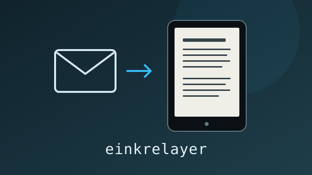

# einkrelayer



Turn links and documents into readable EPUB books and digests, then deliver them
to an e-reader through your own email provider. Use the CLI or email a shared
mailbox; each reader has a label, allowed sender addresses, and Kindle destinations.

## Setup

Use Python 3.13 and uv:

```sh
uv sync --locked
cp .env.example .env
cp users.toml.example users.toml
chmod 600 .env users.toml
```

Fill in your SMTP and IMAP settings in `.env` and reader destinations in
`users.toml`. Add your SMTP sender to the Kindle's approved personal-document
sender list. SMTP and IMAP use TLS. The standalone `send` command uses
`KINDLE_EMAIL`; mailbox delivery uses the destinations in `users.toml`.

For image rendering on Linux, install Cairo and DejaVu fonts. Noto CJK fonts and
Pillow with Raqm improve multilingual layouts. Install EPUBCheck with Java, or
unpack it to `.cache/toolchains/epubcheck-<version>/` with `epubcheck.jar` and its
libraries. `uv run python -m einkrelayer.dependencies` checks local tools. Builds
always validate structure and references, and run EPUBCheck when available.

## CLI

```sh
uv run einkrelayer build https://example.org/article --output output/article.epub
uv run einkrelayer build report.pdf notes.md letter.docx --title "Readings"
uv run einkrelayer build --contents https://example.org/book/contents
uv run einkrelayer build article.html notes.txt --mode digest
uv run einkrelayer validate output/article.epub
uv run einkrelayer review output/article.epub
uv run einkrelayer send output/article.epub                # preview
uv run einkrelayer send output/article.epub --to 1 --send   # transmit
```

Inputs include public HTML pages, text-based PDF, DOCX, Markdown, plain text,
and saved HTML. Capture reads static page content and public assets. A page
requiring sign-in, a subscription, or an access challenge is reported as
unavailable. Detection is heuristic; unsupported pages receive a reason.

`--contents` follows an explicit chapter list once, in order, on the same site,
up to 50 chapters. Nested indexes and ambiguous lists receive an error. Normal
CLI source arguments are read individually. `--answer-keys` moves recognized
answer sections into linked chapters. `--mode digest` builds a dated collection.

## Email

Set `RELAY_ADDRESS` in your local `.env` to your receiving mailbox, for example
`readings@example.org`. Send to `readings+<table-name>@example.org`: `[ana]`
uses `readings+ana@example.org`. Usernames match case-insensitively; duplicate table
names that differ only in case are configuration errors. From must appear in
that user's `senders` allowlist. Messages need valid aligned DKIM covering the
body, To address, and command headers. Delivery uses that user's `kindle` list.

The bare receiving address, unknown users, other domains, mismatched
senders, and multiple recipients are rejected. Use exactly one To address without
Cc/Bcc. The mail provider must deliver plus addresses to the shared IMAP inbox.

| Subject | Result on the next run |
| --- | --- |
| Ordinary subject | Add links and documents to that reader's digest queue |
| `book` | Build one book from all links and supported attachments in the email |
| `book: My title` | Build the same book with the supplied title |
| `send now` | Send that reader's ready digest regardless of its threshold or weekday |

Book emails expand explicit contents pages one level; separate emails produce
separate books. A restricted or unreadable chapter prevents that whole book
from being sent. Other submissions continue. Empty `send now` requests complete
without sending; that command must not include links or document attachments.

Each reader needs a `label`, allowed `senders`, and `kindle` destinations.
`min_articles` defaults to 10; `days` can restrict normal digest delivery, and
`title` customizes its subject. Labels appear in operator output. The table name
is the stable reader ID. The same sender may be allowlisted for multiple users.

Attachments are limited to 30 MB each and incoming messages to 40 MB including
email encoding. Linked documents are limited to 100 MB per download; HTML-only
probes use 20 MB and individual image downloads 30 MB. The finished encoded
message must fit `SMTP_MAX_MESSAGE_MB` and your provider's limits. Email books
accept up to 50 input links and 50 resulting chapters. Attachments are kept while
queued and removed after their associated work finishes.

## Run and inspect

```sh
uv run einkrelayer check
uv run einkrelayer run --dry-run
uv run einkrelayer run
uv run einkrelayer queue
uv run einkrelayer history
uv run einkrelayer run --send-now ana
```

Run periodically with cron or a systemd timer using an absolute project directory
and uv executable. Email commands take effect when a run processes the mailbox.
Keep one active consumer per mailbox; configure a dedicated mailbox when testing.

Queue and history output include failure reasons. Confirmed access restrictions
are terminal for that submission; transient failures use scheduled retries.
If delivery is interrupted after transmission begins, inspect it with `history`
and use `resolve ID sent|failed` or preview `resend ID` before `resend ID --send`.
Uncertain deliveries are held for an explicit decision.

Capture diagnostics go to stderr, including fetch failures, retries, contents
checks, and EPUBCheck results. Build JSON goes to stdout. Logs omit URL query
strings, fragments, and credentials; filenames and URL paths may identify reading
material, so keep logs private. Configuration, state, captures, and output stay
in ignored local directories.

## Development

```sh
uv sync --locked --dev
uv run python -m unittest discover -s tests -q
uv run ruff check .
uv run ruff format --check .
```

Tests use synthetic documents, local networking, and fake mail/delivery services.
See `LICENSE` for AGPL-3.0 terms and `DEPENDENCIES.md` for dependency notices.
